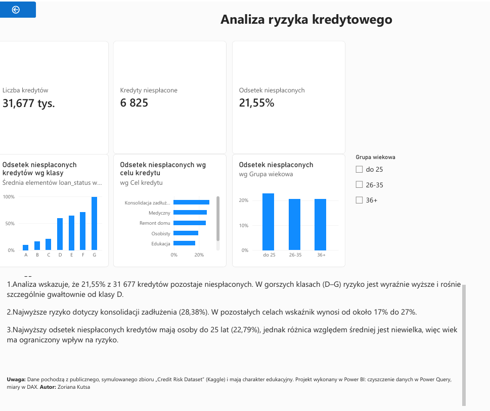

# Credit Risk Analysis: SQL + Power BI

An end-to-end analysis of loan defaults: data cleaning and analysis in **SQL (SQLite, DBeaver)**, and an interactive dashboard in **Power BI**.

## Goal

Find out which borrower and loan characteristics are linked to a higher risk of default.

## Data

[Credit Risk Dataset](https://www.kaggle.com/datasets/laotse/credit-risk-dataset) from Kaggle: 32,581 loan records with borrower age, income, home ownership, employment length, loan intent, loan grade, loan amount, interest rate and loan status (repaid / default).

## What I did

**1. Data cleaning (SQL)**
- Found unrealistic values: age of 123 and 144 years, employment length of 123 years.
- Removed these 7 records (32,581 → **32,574** rows).
- Renamed columns and added a readable `status_text` column (`Default` / `Repaid`).

**2. Analysis (SQL)**
- Overall number of clients and default rate.
- Default rate by loan grade, loan intent and home ownership.

**3. Dashboard (Power BI)**
- KPI cards: default rate and number of clients.
- Bar chart: default rate by loan grade.
- Matrix with heatmap: default rate by home ownership and loan intent.

## Key findings

- Overall default rate: **21.8%** (32,574 clients).
- Risk grows sharply with loan grade: from **10%** in grade A to **98.4%** in grade G.
- Highest default rate by loan intent: **debt consolidation (28.6%)**; lowest: **venture (14.8%)**.
- Renters and the "other" group have the highest default rates (about 31%), homeowners without a mortgage the lowest (about 7.5%).

## Repository contents

| File | Description |
|---|---|
| `01_clean_data.sql` | Data cleaning and creation of the clean table |
| `02_analysis.sql` | Default rate analysis queries |
| `bank.pbix` | Power BI report |
| `bank_credit_risk.pdf` / `.png` | Dashboard export |

## Tools

SQL (SQLite) · DBeaver · Power BI

## Author

Zoriana Kutsa, aspiring Data Analyst
